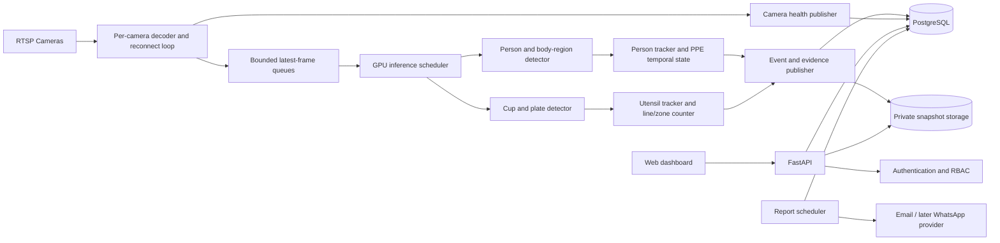

# Kitchen Vision System — Canonical Plan
## Scope, Architecture, Delivery, and Operations

**Status:** Canonical plan  
**Supersedes:** `Kitchen_Vision_System_Design_and_CV_Lifecycle.md` and `Kitchen_Vision_Implementation_Plan_Phases.md` where they conflict  
**Purpose:** Define the system, data, model, evaluation, deployment, operations, and delivery gates for kitchen PPE monitoring and cup/plate counting from RTSP cameras.

> This is a design and delivery specification, not a claim that a model has already been trained. Training weights, accuracy results, camera-specific thresholds, and production readiness require authorized kitchen footage, a held-out evaluation set, live shadow operation, and client sign-off.

---

## 1. Executive Summary

The system receives video from existing kitchen cameras, detects and tracks workers and utensils, determines whether visible PPE requirements are met, counts utensils according to a configured camera zone or crossing line, stores events and summaries, and presents results in a protected dashboard. It can export reports and send scheduled email summaries. WhatsApp is deferred until account setup and approved templates are available.

The system is an **assistive monitoring tool**. It must abstain when the camera does not provide enough visual evidence. A low-confidence, obscured, or too-small view becomes `unclear`, not a violation. Dashboard users can review evidence and correct records; those corrections can inform future training only after review and approval.

### 1.1 Recommended first release

- One site and one or two fixed cameras.
- Offline video replay first, then live RTSP.
- PPE: hair cover, gloves, and mask. Beard and beard-cover detection is deferred until footage supports it.
- Cup and plate counting only after each camera has a signed-off counting definition and zone/line.
- Dashboard with camera health, event review, date/camera filters, and CSV export.
- Email summaries after event data is stable.
- No automated disciplinary action, identity recognition, or face identification.

### 1.2 Delivery offers, not one vague estimate

Replace the earlier “7–10 day MVP” framing with three distinct offers:

| Offer | Typical duration | Includes | Does not include |
|---|---:|---|---|
| Feasibility demo | 5–10 days | Sample frames, baseline overlays, camera visibility review, risk register | Production accuracy, live alerts, soak test |
| Offline MVP | 4–6 weeks | Data, models, logic, replay worker, API, dashboard, exports | Live RTSP hardening, production notifications |
| Production pilot | 3–5 weeks after offline MVP | Shadow deployment, soak test, limited alerts, sign-off | Unlimited cameras or new PPE classes |

Durations depend on footage, camera access, labeling support, and hardware readiness. They are planning scenarios, not accuracy guarantees.

---

## 2. Goals, Non-Goals, and Acceptance

### 2.1 Goals

1. Read configured RTSP streams reliably and recover after connection loss.
2. Assess configured PPE items for each sufficiently visible worker over time.
3. Produce auditable violation events with timestamps, model/config versions, and optional evidence snapshots.
4. Count cups and plates according to a defined per-camera operational meaning.
5. Expose health, event, count, export, and schedule data through an authenticated API and dashboard.
6. Support repeatable data preparation, training, evaluation, model versioning, deployment, and rollback.

### 2.2 Non-goals for the first release

- Recognizing who a worker is, face recognition, or attendance tracking.
- Guaranteeing correct PPE wear when the relevant body region is hidden or too small.
- Counting every item in an arbitrary pile of overlapping dishes from one camera view.
- Automated staff discipline or unsupervised enforcement.
- Sending footage or snapshots to a third-party AI inference service.
- Multi-site tenant billing or a general-purpose video archive.

### 2.3 Acceptance matrix

The following are proposed defaults. The client must sign, amend, or replace them in Phase 0. Evaluate on held-out clips split by recording session/time and preferably by camera/shift. Report results per camera and per item, not only pooled.

| Capability | Metric / formula | Proposed target | Gate action if missed |
|---|---|---:|---|
| PPE precision | `TP/(TP+FP)` on assessable decisions | ≥ 0.90 | Reduce item/camera scope |
| PPE recall | `TP/(TP+FN)` on adjudicated violation windows | ≥ 0.80 | Add violation examples |
| PPE coverage | assessable worker-seconds / visible worker-seconds | ≥ 0.70 | Rework camera or narrow task |
| Unclear rate | unclear decisions / all decisions | ≤ 0.20 | Visibility/threshold review |
| False alerts | judged-wrong violation events / camera-hour | ≤ 2 | Tune grace/cooldown |
| Event delay p95 | event time − source frame time | ≤ 5 s live | Optimize sampler/inference |
| Counting APE | `abs(pred−true)/true`, true ≥ 10 | ≤ 10% | Disable counting for that camera |
| Count MAE | mean `abs(pred−true)` per bucket | ≤ 1 item | Disable or change counting mode |
| Duplicate count rate | duplicate counts / total counts | ≤ 1% | Tracker tuning |
| Stream uptime | connected time / scheduled time | ≥ 99% over 24 h | Infrastructure/RTSP fix |
| Reconnect p95 | disconnect → first valid frame | ≤ 30 s | RTSP backoff fix |

Precision without coverage is misleading: a model that abstains on nearly every frame may have high precision on a few decisions. Always report precision, recall, coverage, `unclear`, false alerts, and event delay together. The client must also state the relative cost of a missed violation versus a false alert before thresholds are tuned.

---

## 3. Requirements and Domain Definitions

### 3.1 User roles

- **Viewer:** Can see permitted dashboards and export reports.
- **Reviewer:** Can inspect events, mark an event correct/incorrect/unclear, and add a reason.
- **Administrator:** Can manage sites, cameras, zones, thresholds, users, and report schedules.
- **Service identity:** Camera worker and scheduler authenticate with limited service credentials; they do not use human accounts.

### 3.2 Functional requirements

| ID | Requirement |
|---|---|
| FR-01 | Configure sites and cameras, with RTSP URI stored as a secret or secret reference. |
| FR-02 | Configure required PPE items and per-camera line/zone geometry. |
| FR-03 | Connect, sample frames, reconnect, and report camera health. |
| FR-04 | Detect people and body regions; associate PPE decisions with tracked people without persistent identity. |
| FR-05 | Emit `compliant`, `violation`, or `unclear` PPE decisions by item and time window. |
| FR-06 | Detect and track cups and plates; count according to an explicitly selected line-crossing or zone mode. |
| FR-07 | Persist violations, count buckets, camera health transitions, model version, config version, and reviewer feedback. |
| FR-08 | Search/filter events and counts by site, camera, item, status, and time range. |
| FR-09 | Export filtered summaries to CSV; PDF can follow after report format is agreed. |
| FR-10 | Schedule and send email reports; support WhatsApp only after provider setup and template approval. |
| FR-11 | Show camera online/offline, processing lag, latest frame time, and worker health. |
| FR-12 | Allow a reviewer to inspect evidence and record a correction with audit history. |

### 3.3 PPE state vocabulary

For each track and PPE item:

- `present`: the required item is visibly worn with sufficient evidence.
- `absent`: the relevant region is visible and evidence supports non-compliance.
- `unclear`: the region is occluded, too small, out of view, blurry, or predictions conflict.
- `not_applicable`: item not required by the camera/site policy.

Persist derived event status as `violation`, `compliant`, or `unclear`. Keep raw per-frame observations short-lived or sampled for diagnostics; do not turn raw video into a permanent archive by default.

### 3.4 Counting modes

Every camera must use one explicit mode per class:

1. **Line crossing:** Count an item once when its tracked center crosses a configured line in the selected direction.
2. **Zone entry:** Count an item once on confirmed entry into a polygon during a time bucket.
3. **Zone occupancy:** Estimate visible items in a zone at a sampling time. This is not cumulative throughput.

Additional signed rules:

- Stacks: choose `plate_stack` as a separate class and decide whether a stack counts as one stack, an estimated plate count, or `unclear`. A single-view detector cannot reliably recover hidden plate count.
- Multi-camera: no cross-camera identity tracking. Site-level deduplication is allowed only where fields of view do not overlap; otherwise declare cross-camera deduplication out of scope.
- Buckets: 15-minute default, UTC storage, site timezone rendering, explicit DST fold rule.
- Unsupported view: if a camera fails the counting feasibility gate, disable counting for that camera rather than publishing misleading counts.

---

## 4. Numeric Camera Feasibility Gate

Complete before committing to model accuracy targets or large-scale labeling. These are starting thresholds to validate on sample frames; record the final agreed values per camera.

| Check | Starting threshold | Evidence | Decision |
|---|---:|---|---|
| Person bbox height | ≥ 200 px | Sample frames across shifts | Pass / narrow task / reject camera |
| Head/face region | ≥ 40×40 px | Sample frames | Pass / drop hair-cover item |
| Hand region | ≥ 25×25 px | Sample frames | Pass / drop glove item |
| PPE region | ≥ 30×30 px | Sample frames | Pass / drop affected item |
| Focus/sharpness | Laplacian variance ≥ 100 | Assessable frames | Pass / reposition camera |
| Motion blur | < 1% of sampled frames rejected | Sample clips | Pass / higher shutter or FPS |
| Resolution | ≥ 1280×720 | Camera metadata | Pass / reject for small items |
| Frame rate | ≥ 15 fps | Camera metadata | Pass / reduce task scope |
| Video codec | H.264 preferred | RTSP probe | Pass / decoder risk noted |
| Transport | RTSP/TCP preferred | RTSP probe | Pass / UDP risk noted |
| Day/night | Separate samples required | IR/low-light clips | Pass / restrict hours |
| Backlighting | Separate samples required | Window/door shots | Pass / restrict task |

Exit rule: if any required PPE region or utensil class fails the pixel/visibility thresholds on representative clips, revise the camera setup or reduce scope before labeling and training.

---

## 5. System Architecture

### 5.1 Logical architecture



### 5.2 Deployment shape

Use a modular monolith for the API and dashboard, plus independently restartable camera workers. Keep CV inference behind an interface so models can be exchanged without changing dashboard or database contracts.

- **API:** FastAPI, SQLAlchemy, Alembic, PostgreSQL.
- **Dashboard:** React + Vite; consume a versioned REST API.
- **Workers:** Python processes. One decoder loop per camera; shared inference scheduler batches frames on available GPU. Queues are bounded.
- **Models:** PyTorch/ONNX Runtime initially; TensorRT only when target hardware and measured throughput justify it.
- **Tracking:** ByteTrack or equivalent, with per-camera tracker state. Do not share tracker IDs across cameras.
- **Snapshots:** Private filesystem volume or object storage; database stores opaque object key, not a public URL.
- **Jobs:** APScheduler for a single-instance MVP. Move to a durable queue/scheduler if multiple API replicas or retry guarantees are needed.
- **Packaging:** Docker Compose for API, dashboard, PostgreSQL, scheduler, and workers. GPU container runtime is optional and must be validated on the chosen host.

### 5.3 Frame flow and backpressure

1. Decoder reads RTSP and timestamps each frame with camera ID and monotonic receive time.
2. Decoder writes latest frame to a bounded queue. When inference falls behind, discard stale frames instead of building a long queue.
3. Scheduler chooses sampling rates by task and camera. PPE and utensil processing can use different rates after profiling.
4. Results include source frame timestamp, model version, confidence, preprocessing version, and processing duration.
5. Event publisher is idempotent; retries must not create duplicate events.
6. Health monitor marks a camera offline after a configured timeout and records recovery.

### 5.4 Failure isolation

- A camera disconnect must not stop another camera.
- A model load failure must make that worker unhealthy and visible; it must not silently report compliance.
- Database/API outage must not create unbounded local queues. Use a bounded retry buffer or fail closed and report degraded status.
- GPU OOM triggers worker restart or reduced batch size; health stays degraded until inference succeeds.
- Every event records the model version and rules/config version that produced it.

---

## 6. AI/CV Model Design

### 6.1 Separate task models first

**Model A: worker/PPE perception**

- Detect person, head/face region, and hands, or use a person detector plus a separately trained body-region detector.
- Prefer a region classifier with `present`, `absent`, and `not_assessable` outputs when the decision is about whether something is worn. A detector can locate positive PPE objects, but absence requires knowing that the relevant body region was visible and assessable.
- Associate region decisions to a person using containment/overlap and a defined matching rule; flag ambiguous associations as `unclear`.
- Track people only within a camera session. Track IDs are temporary technical IDs, not employee identities.

**Model B: utensil detection**

- Detect `cup`, `plate`, and optionally `plate_stack` if the client chooses a distinct stack policy.
- Track detections per camera and count each track once under the configured line/zone rule.
- For zone occupancy, estimate counts periodically and report confidence/visibility limits rather than pretending it is an exact flow count.

Separate models make failure analysis and retraining easier. A single combined model can be evaluated later if profiling shows a deployment benefit.

### 6.2 Dataset and checkpoint candidates

- **PPE warm start:** SH17 includes people, heads, hands, gloves, and several PPE categories, but comes from industrial settings. Use it to initialize experiments, not as proof of kitchen performance. Inspect annotation definitions and license before use.
- **Utensil warm start:** COCO-pretrained detectors include common objects such as cups, but verify the exact selected model’s classes and annotation definitions before relying on it for plates. Open Images can supply class-specific samples where terms and labels match.
- **License gate:** Ultralytics documents YOLO11 under AGPL-3.0 and Enterprise licensing; MMDetection’s repository is Apache-2.0. Check code, checkpoint/weights, dataset, and export-runtime terms separately with the client before selecting a stack.
- **Tracker:** ByteTrack or equivalent; benchmark ID continuity and counting errors on representative clips.
- **Fallbacks:** no suitable PPE checkpoint → train region classifier from the pilot dataset; no GPU → offline replay only at reduced sampling, no live FPS promise.

Do not assume a public dataset contains the exact classes, camera conditions, or rights needed. Record source URL, version, license, attribution requirements, and allowed use for each dataset/checkpoint.

### 6.3 Model interface

Implement adapters with typed inputs/outputs, independent of framework:

```python
class PersonPPEModel:
    def predict(self, frame) -> list[PersonObservation]: ...

class UtensilModel:
    def predict(self, frame) -> list[UtensilObservation]: ...

class PersonObservation:
    bbox: tuple[float, float, float, float]
    person_confidence: float
    regions: list[BodyRegionObservation]
    ppe: dict[str, PPEPrediction]

class PPEPrediction:
    state: str  # present | absent | not_assessable
    confidence: float
    evidence_bbox: tuple[float, float, float, float] | None

class UtensilObservation:
    class_name: str  # cup | plate | plate_stack
    bbox: tuple[float, float, float, float]
    confidence: float
```

Production outputs also carry `camera_id`, frame timestamp, model version, preprocessing version, and inference duration. Never couple business rules to a vendor-specific result object.

### 6.4 Dataset plan

**Collection:** Obtain authorized clips from each camera, multiple shifts, normal and difficult conditions, and examples of compliant/non-compliant cases. Store originals in access-controlled storage with retention limits. Extract frames at a rate appropriate to motion, then deduplicate near-identical frames.

**Volume targets for the pilot:**

- 6–10 hours of authorized footage per pilot camera across shifts.
- Extract 2,000–5,000 frames, dedupe to 1,500–3,000 annotated images.
- ≥ 200 instances per PPE item per state (`present`, `absent`, `not_assessable`).
- ≥ 100 utensil instances per class and size band.
- ≥ 20–30 held-out clips, 2–5 minutes each, stratified by camera/shift; freeze the test split.

**Annotation tool:** CVAT or Label Studio. Maintain a versioned annotation guide. Label a pilot subset first, review disagreements, update the guide, then scale labeling.

**PPE labels:**

- Person boxes and temporary person group ID within each image/frame.
- Head/face and hand regions with visibility (`visible`, `partly_visible`, `occluded`, `too_small`).
- Per-item state: present, absent, not assessable.
- Hair cover, gloves, mask, beard, beard cover only where the view supports reliable judgment.
- Do not infer `absent` if the relevant region is not visible.

**Utensil labels:**

- Tight boxes for cups/plates; optional stack class only if the policy defines it.
- Occlusion/visibility tags; ground truth at the operational level (crossings, zone entries, or occupancy snapshot).
- Consistent object IDs across sampled frames where feasible.

**Quality control:**

- Double-label 10% of the pilot set.
- Require Cohen’s kappa ≥ 0.75 or Krippendorff α ≥ 0.8 on double-labeled items.
- Adjudicate disagreements, update the guide, and relabel affected items if needed.
- Oversample rare violations, glove colors, hair-cover styles, masks, occlusion, and stacks.

**Splitting:** Split by recording session/time and preferably hold out one camera or shift. Do not random-split adjacent frames. Freeze a test set; do not tune thresholds against it.

**Dataset manifest:** Keep `training/DATASET.md` with source, consent/authorization, camera, timestamps, label version, classes, exclusions, split, license, and checksums. Remove credentials and sensitive metadata from exports.

### 6.5 Training lifecycle

1. **Baseline:** Run pretrained models on labeled clips; save predictions and frame-level metrics.
2. **Error review:** Group false positives/negatives by camera, object size, lighting, occlusion, and class. Decide whether the issue is labels, model, camera, or rule.
3. **Fine-tune:** Train one task at a time. Start from a pretrained checkpoint where suitable; keep a reproducible config, seed, package versions, dataset manifest, and code commit.
4. **Augment carefully:** Brightness/contrast, mild blur, scale/crop, and occlusion augmentations resembling real footage. Avoid augmentations that erase PPE cues or create unrealistic labels.
5. **Handle imbalance:** Oversample rare violation states; choose loss/class weights from validation data only.
6. **Tune thresholds:** Select per-class thresholds on validation data using the agreed missed-violation vs false-alert cost. Keep thresholds versioned separately from weights.
7. **Compare:** Evaluate candidate and baseline on the same frozen validation/test clips.
8. **Package:** Export model, label map, preprocessing spec, thresholds, metrics, checksum, license notices, and runtime compatibility metadata.
9. **Promote:** Require human review of hard examples and sign-off before deploying a model to live cameras.

Use MLflow or an equivalent tracker if multiple experiments are expected. DVC or a controlled object store can version datasets and artifacts. These tools are optional for a one-model pilot, but experiment metadata is not optional.

---

## 7. Evaluation and Release Gates

### 7.1 Evaluation protocol

- Use the frozen held-out clips defined in the acceptance matrix; 20–30 representative clips is a starting point, more may be needed for shift/camera diversity.
- Label ground truth independently of model outputs where possible. Adjudicate disagreements.
- Split by time/camera; document exact clips and hashes.
- Evaluate both frame/region decisions and final emitted events.
- Report per-camera and per-item results, not only a pooled score.
- Include failure examples and conditions where the camera is not suitable.

### 7.2 Metrics

**PPE:** precision, recall, F1 by item; confusion matrix for present/absent/not-assessable; coverage; unclear rate; false events per camera-hour; event delay; duplicate event rate.

**Detection:** AP/mAP by class and object-size band as a diagnostic. Detection AP alone does not prove that PPE compliance or count events are correct.

**Counting:** MAE, mean absolute percentage error where denominator is meaningful, signed bias, duplicate count rate, missed count rate, and count error by interval/camera. Manually annotate actual crossings or the chosen ground-truth definition.

**Operations:** camera uptime, reconnect time, decode FPS, inference FPS, queue depth, stale-frame drops, inference latency p50/p95, end-to-end event delay, CPU/GPU/memory, database write failures, and snapshot storage growth.

### 7.3 Promotion gates

1. **Data gate:** authorization, annotation guide, split, IAA result, and license manifest complete.
2. **Offline gate:** baseline and candidate evaluated on frozen clips; failure review complete.
3. **Shadow gate:** live predictions visible to reviewers but no operational alerts; collect feedback and calibrate.
4. **Limited production gate:** agreed cameras/items enabled; alert thresholds and rollback artifact available.
5. **Scale gate:** soak test and per-camera capacity demonstrated before adding cameras.

If metrics miss target, diagnose the cause before adding model size: camera angle, insufficient pixels, label ambiguity, domain gap, or tracking/count definition may dominate.

---

## 8. Temporal PPE and Counting Logic

### 8.1 Temporal PPE decision logic

Do not count adjacent frames as independent votes. Use a time-based window and require sufficient visibility and evidence diversity.

Per tracked person/item state machine:

```text
UNKNOWN -> OBSERVING
OBSERVING -> COMPLIANT       when enough high-quality evidence says present
OBSERVING -> SUSPECTED       when enough high-quality evidence says absent
SUSPECTED -> VIOLATION       after persistence/grace threshold is met
ANY       -> UNCLEAR         when evidence is insufficient, stale, or conflicting
VIOLATION -> COOLDOWN        after event emitted; suppress duplicate alerts
```

Rules:

- Require region visibility and minimum pixel size before accepting present/absent decisions.
- Use timestamps, not a fixed number of frames, because frame rates vary.
- Apply a per-camera/per-item grace period and cooldown.
- Reset state when a track ends; do not associate a new person solely by old track ID.
- Emit one event per person-track/item/violation episode and attach evidence selected by policy.
- Keep uncertainty visible in dashboards; do not translate missing detections to violations.

### 8.2 Counting logic

For line crossing:

1. Track each detected cup/plate within a camera.
2. Smooth the object center over a short period.
3. Require the center to be on one side of the line for a minimum duration, then cross a margin on the other side.
4. Count only the allowed direction; mark the track as counted.
5. Handle ID loss with a short re-identification tolerance and expose likely duplicate/uncertain counts for review.

For zone entry, count a track after it remains inside the polygon long enough and was previously outside. For occupancy, detect/deduplicate within each sampling interval and report a snapshot count, not a cumulative count.

---

## 9. Data Model

Recommended PostgreSQL entities:

| Table | Key fields / purpose |
|---|---|
| `sites` | `id`, name, timezone, retention policy |
| `cameras` | `id`, `site_id`, name, secret reference, active state, resolution, sampling profile |
| `camera_configs` | versioned PPE rules, polygons/lines, direction, count mode, thresholds, effective time |
| `model_releases` | model ID, task, version, checksum, labels, preprocessing, metrics, license metadata, status |
| `compliance_events` | camera, event time, temporary track ID, item, status, confidence summary, model/config version, evidence keys, idempotency key |
| `count_events` | camera, time, class, direction, track ID, mode, confidence, model/config version |
| `count_buckets` | camera, interval, class, count, uncertain count, source event range |
| `camera_health_events` | camera, state, time, reason, worker version |
| `review_feedback` | event, reviewer, disposition, reason, time; append-only audit |
| `report_schedules` | owner, channel, recipient secret reference, timezone, recurrence, filters, enabled |
| `audit_log` | actor/service identity, action, target, timestamp, request ID |

Constraints and indexes:

- Foreign keys for site/camera/model relationships.
- Index `(camera_id, occurred_at DESC)` for event and health timelines.
- Unique `idempotency_key` for publisher retries.
- `idempotency_key = hash(camera_id, temporary_track_id, item, episode_bucket, model_version, camera_config_version)`.
- Counts stored with explicit time bucket and semantic mode.
- UTC timestamps in storage; convert to site timezone in reports.
- Never store raw passwords or RTSP passwords in ordinary configuration rows.

Evidence policy:

- Three frames per violation episode: pre/on/post.
- JPEG, long edge ≤ 1280 px, encrypted at rest, checksummed.
- Default retention 30 days; no snapshots for compliant cases by default.
- Database stores opaque object keys; evidence endpoints authorize every request.

---

## 10. API and Dashboard Contract

### 10.1 API endpoints

```text
POST   /api/v1/auth/login
GET    /api/v1/sites
GET    /api/v1/cameras?site_id=&status=
POST   /api/v1/cameras
PATCH  /api/v1/cameras/{camera_id}
GET    /api/v1/cameras/{camera_id}/health
GET    /api/v1/events?site_id=&camera_id=&item=&status=&from=&to=&page=
GET    /api/v1/events/{event_id}
POST   /api/v1/events/{event_id}/review
GET    /api/v1/counts/summary?site_id=&camera_id=&class=&from=&to=&bucket=
GET    /api/v1/counts/series?camera_id=&class=&from=&to=&bucket=
GET    /api/v1/exports/events.csv?...filters
GET    /api/v1/exports/counts.csv?...filters
POST   /api/v1/report-schedules
GET    /api/v1/report-schedules
PATCH  /api/v1/report-schedules/{schedule_id}
GET    /api/v1/evidence/{opaque_key}
GET    /health/live
GET    /health/ready
```

Use pagination, validated filters, bounded date ranges, structured errors, request IDs, and explicit API versioning. Rate-limit authenticated endpoints. Evidence endpoints use opaque UUID keys, authorize every request, and return signed URLs valid for no more than 5 minutes when required.

### 10.2 Dashboard screens

1. **Overview:** today’s counts, PPE event totals, unclear rates, camera health, and processing lag.
2. **Events:** filterable table; event detail with camera/time/item/status/model version/config version and authorized evidence preview.
3. **Counts:** per-camera time series with selected counting semantics and export.
4. **Camera setup:** stream health, safe preview, draw/adjust line or polygon, configure direction and item policy.
5. **Reports:** export and schedule email summaries.
6. **Admin/audit:** user access, rule/model version history, and reviewer actions.

Show an explicit stale/degraded banner when camera or inference health is not current. Missing data must never look like zero violations.

---

## 11. Security, Privacy, and Responsible Operation

- Obtain documented authorization to process camera footage and define staff notice/retention with the client.
- Avoid identity recognition; use ephemeral track IDs scoped to a camera session.
- Minimize snapshot capture as defined in Section 9.
- Restrict raw video, snapshots, exports, and RTSP credentials by role and service identity.
- Store credentials in environment secrets or a secret manager; redact RTSP URLs from logs.
- Authentication: OIDC if available, otherwise local Argon2 password hashing; MFA for administrators; 15-minute access tokens; optional refresh tokens.
- Use TLS in transit, RBAC, CSRF protection for cookie-based browser sessions, rate limiting, and audit logs.
- Escape user-generated text and validate camera configuration inputs.
- Use private storage; signed short-lived evidence URLs only if required.
- Make human review and correction available. Do not allow the model to make employment or disciplinary decisions automatically.
- Define retention/deletion for footage, snapshots, event data, exports, and backups, including data subject access/deletion requests.
- Pin dependencies and scan container images; record model/data license notices in release artifacts.
- Obtain legal/privacy review before processing live footage.

---

## 12. Canonical Delivery Phases

Move to the next phase when the gate is met; do not treat calendar dates as evidence of model readiness.

### Phase 0 — Scope, camera review, and data readiness

**Goal:** Confirm tasks are observable and define measurable success.

**Work:**

1. List sites, cameras, locations, resolutions, frame rates, angles, and simultaneous stream counts.
2. Obtain authorized sample footage per camera covering shifts and lighting.
3. Apply the numeric camera feasibility gate in Section 4.
4. Define PPE policy by station: required items, visibility rules, grace period, alert cooldown.
5. Select counting meaning per camera/class and decide stack/overlap handling.
6. Confirm hardware, storage, retention, roles, and local vs hosted inference.
7. Decide licensing constraints for code, weights, datasets, and deployment.
8. Sign the acceptance matrix in Section 2.3 and identify held-out clips.

**Deliverables:** camera inventory, sample-frame review, signed scope/acceptance matrix, authorization/privacy decisions, per-camera rules, risk register, chosen pilot camera(s).

**Exit gate:** required PPE regions/items are visible enough, counting semantics are unambiguous, and the acceptance matrix is signed.

### Phase 1 — Data, model, and technology decisions

**Goal:** Make explicit, evidence-based choices before building around assumptions.

**Work:**

1. Record data provenance, license, authorization, retention, and permitted training use.
2. Compare PPE warm-start options and verify class maps; use SH17 only where labels fit.
3. Compare utensil candidates; verify plate/cup classes explicitly.
4. Benchmark detector framework options with license fit: easy-to-iterate YOLO11 vs Apache-2.0 MMDetection option.
5. Choose tracking, inference runtime, and platform stack.
6. Record primary and fallback choices with rejection reasons.

**Deliverables:** `DECISIONS.md`, dataset/checkpoint license register, candidate benchmark table, architecture decisions, approved MVP/deferred list.

**Exit gate:** provenance/terms known, a candidate runs on representative footage, runtime hardware and stack selected, semantics agreed.

### Phase 2 — Dataset and annotation foundation

**Goal:** Create a small, trustworthy kitchen-specific dataset.

**Work:**

1. Create private data store; keep footage, credentials, and snapshots out of Git.
2. Extract and dedupe frames per Section 6.4.
3. Write annotation rules with positive, negative, occluded, too-small, and ambiguous examples.
4. Label pilot subset in CVAT or Label Studio.
5. Double-label 10%, measure IAA, adjudicate, and update guide.
6. Split by session/time and freeze test set.
7. Create dataset manifest with checksums and license details.

**Deliverables:** `training/DATASET.md`, label guide, train/val/test manifests, annotated pilot export, quality notes.

**Exit gate:** label guide understood, IAA acceptable, test set frozen, data representative enough for baseline.

### Phase 3 — Baseline CV feasibility

**Goal:** Measure what pretrained models can do on actual camera views.

**Work:**

1. Build repeatable offline clip runner saving timestamped predictions and annotated review videos.
2. Verify class maps and licenses for candidate checkpoints.
3. Run pretrained person/PPE and utensil candidates.
4. Produce per-class metrics and inspect failures by camera, size, lighting, occlusion.
5. Measure inference speed and memory on target hardware.
6. Diagnose dominant issue: visibility, labels, domain gap, model, or counting semantics.
7. Begin API/database schema work once event/count contract stabilizes.

**Deliverables:** baseline predictions, annotated clips, `training/RESULTS.md`, model/license decision, hardware profile, updated scope if needed.

**Exit gate:** team can explain what baseline detects reliably, what it misses, and whether fine-tuning is likely to help. No production accuracy claim.

### Phase 4 — Model development and offline evaluation

**Goal:** Train and compare reproducible kitchen-specific candidates.

**Work:**

1. Keep PPE/person-region and utensil experiments separate initially.
2. Fine-tune with versioned config, seed, package versions, code commit, dataset manifest.
3. Add kitchen-specific PPE labels; beard classes only with sufficient examples.
4. Tune image size/model scale from pixel sizes and hardware performance.
5. Use realistic augmentations and review them.
6. Tune thresholds on validation clips, never the frozen test set.
7. Evaluate candidate and baseline on same held-out clips.
8. Package weights, preprocessing, class map, thresholds, checksums, metrics, license notices.

**Deliverables:** reproducible training/evaluation commands, versioned artifacts, per-class/per-camera report, failure gallery, model card.

**Exit gate:** candidate meets agreed offline targets or client signs off reduced scope/known limitation. Not yet live-approved.

### Phase 5 — Temporal PPE decisions and counting logic

**Goal:** Convert frame detections into stable events and counts.

**Work:**

1. Add per-camera person tracking and person-to-region association.
2. Implement visibility/minimum-pixel gates; route insufficient evidence to `unclear`.
3. Implement time-based state machine with grace, persistence, cooldown, track-end behavior.
4. Prevent duplicate PPE events; keep temporary track IDs only within camera session.
5. Add utensil tracking and per-camera line/zone geometry.
6. Implement line crossing, zone entry, and occupancy per signed semantics.
7. Evaluate complete clips for false alerts/hour, event delay, duplicate/missed counts, count bias.
8. Add idempotent publishing and model/config version metadata.

**Deliverables:** state machine and unit fixtures, line/zone counter, clip-level report, agreed handling for stacks/occlusion/track loss.

**Exit gate:** clip replay produces stable episode events/counts with no duplicate explosion and explicit uncertainty.

### Phase 6 — Offline end-to-end application

**Goal:** Integrate replay, inference, persistence, API, and dashboard before live RTSP.

**Work:**

1. Implement worker interfaces for frame input, prediction, tracking, event logic, publishing.
2. Implement database migrations from Section 9.
3. Implement authenticated FastAPI endpoints from Section 10.
4. Implement dashboard pages from Section 10.2.
5. Support clip replay with source timestamps and deterministic model/config selection.
6. Add role checks, private evidence access, credential redaction.
7. Add CSV exports; defer PDF until format is specified.
8. Add health status so missing/stale inference cannot display as zero violations.
9. Package with development compose config and example configs without secrets.

**Deliverables:** offline runnable app, API schema/migrations, dashboard preview, exports, example deployment, initial runbook.

**Exit gate:** selected clip becomes expected persisted events/counts, displays in UI, enforces authorization, and exports the same filtered records.

### Phase 7 — Live RTSP shadow deployment

**Goal:** Prove live reliability and event quality without operational alerts.

**Work:**

1. Add per-camera decoder/reconnect loops with secret references, bounded queues, stale-frame dropping.
2. Add shared GPU scheduler and per-camera tracker state; isolate camera failures.
3. Add stream health, last-frame time, decode/inference FPS, queue/drop metrics, latency, heartbeat.
4. Deploy to one or two pilot cameras; predictions shadow-only.
5. Compare sampled live outputs with manual review; collect false positives, misses, unclear cases, count discrepancies.
6. Profile CPU/GPU/memory/storage; tune sampling/model size only against measured constraints.
7. Test RTSP interruption, network recovery, DB outage, model load failure, worker restart.
8. Run agreed soak test, e.g. 24 hours, only on actually available hardware.
9. Adjust thresholds on a calibration set, then re-evaluate on frozen test set.

**Deliverables:** shadow report, per-camera thresholds/readiness matrix, capacity estimate, failure test notes, updated runbook and rollback procedure.

**Exit gate:** streams bounded and recovering; latency/uptime targets met; event quality meets signed criteria; reviewers understand limitations.

### Phase 8 — Limited production and reporting

**Goal:** Enable approved operational use for selected cameras/features.

**Work:**

1. Enable only cameras/items that passed shadow gate.
2. Enable events and dashboard notifications under agreed alert policy.
3. Test email summaries, recipient authorization, timezone, retries, duplicate-send protection.
4. Add scheduled reports with bounded query ranges and audit records.
5. Add WhatsApp only if contractually required and provider credentials/templates are ready.
6. Validate CSV/PDF contents against dashboard filters and retention permissions.
7. Verify backups, restore, evidence retention deletion, secret rotation, incident contact path.
8. Obtain client sign-off for acceptance report and known limitations.

**Deliverables:** limited production release, release manifest, final acceptance report, operator/admin guides, scheduled email config, optional WhatsApp integration.

**Exit gate:** client accepts camera/item set, support process, privacy settings, thresholds, and documented limitations.

### Phase 9 — Monitoring, feedback, and retraining

**Goal:** Maintain quality as cameras, shifts, uniforms, lighting, and workflows change.

**Work:**

1. Monitor availability, stale frames, latency, resources, unclear rate, reviewer correction rate, count drift, storage.
2. Review representative errors periodically with authorized reviewers.
3. Promote feedback to training data only after human confirmation and updated annotation/version records.
4. Detect drift by camera/shift; never automatically retrain on unreviewed predictions.
5. Retrain candidates with new dataset manifest; compare to frozen regression suite.
6. Shadow new model before promotion; keep rollback to prior model/config.
7. Update model card, results, runbook, licenses, changelog per release.

**Deliverables:** periodic quality/operations report, reviewed labeling backlog, model release changelog, rollback record.

**Exit gate:** each model change traceable, evaluated, approved, reversible; health and quality trends visible.

---

## 13. Workstream Sequencing, Timeline, and RACI

| Workstream | Starts | Parallel with | Must wait for |
|---|---|---|---|
| Client requirements/camera audit | Phase 0 | API planning | Nothing |
| Data/model/tech selection | Phase 1 | API planning | Phase 0 constraints, sample footage |
| Dataset/annotation | Phase 2 | Schema discovery | Data choice, footage, label policy |
| CV baseline/training | Phase 3 | API scaffolding | Labeled pilot data, license review |
| PPE temporal/count logic | Phase 5 | Dashboard | Stable model outputs, counting rules |
| API/database | Late Phase 3 | Model experiments | Event/count contract |
| Dashboard | Phase 6 | Live worker hardening | API contract, sample events |
| RTSP/deployment | Phases 6–7 | UI polish | Hardware, credentials |
| Notifications | Phase 8 | Operations docs | Stable event data/provider setup |

Assign one accountable owner per phase in the project kickoff. Track external dependencies: footage, RTSP access, hardware procurement, license approvals, reviewer availability, and client sign-off. Add cost estimates and named risk owners to the project register in Phase 0.

---

## 14. Repository and Code Organization

```text
kitchen-vision/
  configs/
    cameras.example.yaml
    rules.example.yaml
  data/
    README.md                 # no private footage committed
  training/
    datasets/
    ppe/
      train.py
      evaluate.py
    utensils/
      train.py
      evaluate.py
    common/
      manifests.py
      metrics.py
    DATASET.md
    RESULTS.md
  worker/
    ingest/
      rtsp_reader.py
      reconnect.py
    pipeline/
      scheduler.py
      frame_types.py
    models/
      registry.py
      person_ppe_adapter.py
      utensil_adapter.py
    tracking/
      person_tracker.py
      utensil_tracker.py
    logic/
      ppe_state_machine.py
      line_counter.py
      zone_counter.py
    publisher/
      events.py
      evidence.py
    health.py
  api/
    app.py
    routes/
    schemas/
    services/
    db/
      models.py
      migrations/
    auth/
    jobs/
  dashboard/
  deployment/
    docker-compose.yml
    Dockerfile.api
    Dockerfile.worker
    Dockerfile.dashboard
  docs/
    SYSTEM_DESIGN.md
    RUNBOOK.md
    DECISIONS.md
  tests/
    unit/
    integration/
    video_regression/
```

Keep video and model weights out of Git. Store model artifacts in a versioned artifact store and use a manifest/checksum in deployments.

---

## 15. Testing Strategy

- **Unit:** PPE state machine, visibility gates, geometry, line crossing, zone entry, cooldowns, idempotency keys, threshold loading.
- **Model regression:** fixed image/clip suite with expected detections and tolerance ranges; store model version and input hashes.
- **Video integration:** replay clips through decoder abstraction, detector, tracker, event publisher, and database; verify final event/count output.
- **API integration:** permissions, filters, pagination, exports, schedule CRUD, evidence access, audit records.
- **Resilience:** RTSP disconnect/reconnect, slow inference, DB unavailable, corrupt frames, model load failure, GPU memory pressure, scheduler retry.
- **Security:** unauthorized snapshot access, role checks, secret redaction, input validation, export leakage, session/CSRF behavior.
- **Performance:** per-camera FPS, p50/p95 latency, GPU memory, stale frame ratio, DB throughput, storage growth.
- **Acceptance:** human-labeled held-out clips and live shadow review; report failures as well as headline metrics.
- **CI:** run `pytest`, `ruff`, `mypy`, Alembic migration check, artifact checksum verification, and Docker build on every change. Target ≥ 80% coverage on logic modules.

---

## 16. Operations and Monitoring

### 16.1 Metrics and alerts

- Camera: connected state, last frame time, reconnect attempts, decode FPS.
- Inference: queue depth, stale-frame drops, model duration, GPU utilization/memory, errors.
- CV quality: assessable/unclear ratio, event frequency, reviewer correction rate, count discrepancies.
- Backend: API latency/errors, DB pool, failed writes, scheduler lag/retries.
- Storage: evidence bytes, retention deletion failures, backup status.

Alert operators when a camera is offline, frame timestamps are stale, inference is degraded, a report repeatedly fails, or evidence retention cleanup fails. Do not interpret missing inference as clean compliance.

### 16.2 Model release and rollback

Each release is immutable and includes weights, checksum, class map, preprocessing, thresholds, training data manifest, code commit, runtime requirements, evaluation results, and license notices. Deploy canary/shadow first. Roll back by selecting the prior artifact/config, not by retraining in production.

### 16.3 Backup and restore

- Daily PostgreSQL dump and snapshot-store backup.
- Monthly restore drill with documented result.
- 30-day backup retention default, aligned to evidence retention policy.
- Encrypt backups and restrict restore credentials.

### 16.4 Runbook topics

- Add/rotate an RTSP credential.
- Review camera and GPU health.
- Change a camera line/zone and version config.
- Investigate false positives/negatives with evidence.
- Disable a camera safely.
- Restore database and evidence backups.
- Roll back a model release.
- Delete footage/evidence on request or retention expiry.

---

## 17. Risks and Mitigations

| Risk | Effect | Mitigation |
|---|---|---|
| Kitchen footage unavailable or late | No credible domain validation | Data readiness is Phase 0 entry condition; feasibility demo only until data arrives |
| Low resolution/poor angle | PPE and small utensils not visible | Numeric camera gate in Section 4; reposition or narrow scope |
| Domain gap from public data | Weak kitchen performance | Fine-tune on kitchen footage; evaluate by camera/shift |
| PPE absence confused with occlusion | False accusations | Visibility states, abstention, temporal evidence, human review |
| Stacks/overlap | Systematic count error | Signed stack semantics; configure view; return uncertainty |
| Tracker ID switches | Duplicate/missed counts/events | Per-camera tracker tuning, hysteresis, idempotency, clip-level evaluation |
| GPU unavailable/underpowered | Low FPS/latency | Profile early; lower sampling, smaller model, or provision hardware |
| Licensing mismatch | Commercial delivery blocked | Review code, weights, data, runtime licenses before training/deployment |
| Privacy/retention gaps | Staff and client risk | Minimize storage, restrict access, notice/retention, audit downloads |
| False sense of accuracy | Poor operational decisions | Report coverage/failures; shadow period; no automatic discipline |
| WhatsApp approval delay | Scheduled messaging unavailable | Ship CSV/email first; start provider setup separately if required |

---

## 18. Handover Deliverables

1. Source code for API, dashboard, worker, training/evaluation scripts, migrations, deployment.
2. Model weights in agreed runtime formats with checksums and license notices.
3. `training/DATASET.md` with sources, authorization, classes, annotation guide, split, counts, licenses.
4. `training/RESULTS.md` with per-class/per-camera metrics, thresholds, false alerts, count error, failures.
5. `docker-compose.yml`, example config without secrets, reproducible setup/run commands.
6. Model card/release manifest with intended use, limits, training data, evaluation.
7. Operator runbook, privacy/retention config, backup/restore, rollback procedure.
8. Acceptance evidence from held-out clips and live soak test.
9. Signed acceptance matrix, decision log, and known limitations register.

---

## 19. Decisions Required Before Coding Against Real Cameras

- Which cameras and what RTSP profiles/resolutions are available?
- Which PPE items are mandatory at each station, and what are the grace/cooldown periods?
- Is a cup/plate count a crossing flow, zone entry, or visible inventory snapshot?
- How are stacks and partially hidden objects counted?
- Where does processing run, what GPU is available, and how many cameras are expected?
- What footage is authorized, who may view it, and how long may evidence be retained?
- Is delivered code/model proprietary/commercial, and which licenses are acceptable?
- Which acceptance clips and metrics will the client sign off?
- Is email sufficient for first release, or is WhatsApp contractual?
- Who owns each phase, and who signs the gate decisions?

Until these are answered, implement framework code with sample video and synthetic fixtures; do not claim production validation.

---

## Appendix A — Phase Mapping from Superseded Documents

| Canonical phase | Old design phase | Old implementation phase |
|---|---|---|
| 0 Scope & feasibility | Phase 0 | Phase 0 |
| 1 Decisions & stack | — | Phase 1 |
| 2 Data & annotation | Phase 1 (data subset) | Phase 2 |
| 3 Baseline CV | Phase 1 (baseline subset) | Phase 3 |
| 4 Model development | Phase 2 | Phase 4 |
| 5 Temporal/counting | Phase 2 (event logic subset) | Phase 5 |
| 6 Offline end-to-end | Phase 3 | Phase 6 |
| 7 Live shadow | Phase 4 | Phase 7 |
| 8 Limited production | Phase 5 | Phase 8 |
| 9 Operations/improvement | Phase 6 | Phase 9 |

---

## Appendix B — Sign-off Templates

### Acceptance sign-off

| Field | Value |
|---|---|
| Client representative | |
| Date | |
| Cameras in scope | |
| PPE items in scope | |
| Counting mode per camera/class | |
| Signed metric targets | |
| Held-out clip IDs/hashes | |
| Known limitations accepted | |
| Gate decision | Pass / Re-scope / Stop |

### Decision log entry

| Field | Value |
|---|---|
| Decision ID | |
| Date | |
| Options considered | |
| Chosen option | |
| Evidence/benchmark | |
| License/provenance notes | |
| Fallback | |
| Rejection reasons | |
| Approver | |

### Model release manifest

| Field | Value |
|---|---|
| Model ID/version | |
| Task | |
| Weights checksum | |
| Class map version | |
| Preprocessing version | |
| Threshold file version | |
| Dataset manifest version | |
| Code commit | |
| Runtime requirements | |
| Metrics summary | |
| License notices | |
| Approver | |
| Rollback artifact | |
