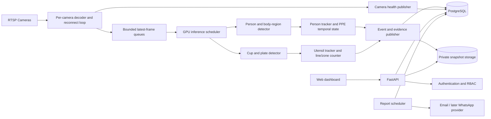

# Kitchen Vision System
## System Design and AI/CV Engineering Lifecycle

**Status:** Reference document — superseded where conflict  
**Purpose:** Define the system, data, model, evaluation, deployment, and operations process for kitchen PPE monitoring and cup/plate counting from RTSP cameras.

> **Canonical plan:** Use `Kitchen_Vision_Plan.md` for current scope, phase numbering, acceptance targets, and decisions. This document is retained for detailed design background.

> This is a design and implementation specification, not a claim that a model has already been trained. Training weights, accuracy results, and camera-specific thresholds require authorized kitchen footage and a held-out evaluation set.

---

## 1. Executive Summary

The system receives video from existing kitchen cameras, detects and tracks workers and utensils, determines whether visible PPE requirements are met, counts utensils according to configured camera zones or crossing lines, stores events and summaries, and presents the results in a protected dashboard. It can export reports and send scheduled email summaries. WhatsApp notifications are a later integration because account setup and approved templates may be required.

The system is an **assistive monitoring tool**. It must abstain when the camera does not provide enough visual evidence. A low-confidence or obscured view becomes `unclear`, not a violation. Dashboard users can review evidence and correct records; those corrections can inform future training only after review and approval.

### Recommended first release

- One site and one or two fixed cameras.
- Offline video replay first, then live RTSP.
- PPE: hair cover, gloves, and mask; beard and beard-cover detection deferred until footage supports it.
- Cup and plate counting only after each camera has a signed-off counting definition and zone/line.
- Dashboard with camera health, event review, date/camera filters, and CSV export.
- Email summaries after event data is stable.
- No automated disciplinary action, identity recognition, or face identification.

The supplied project plan scopes a narrow MVP at roughly 7-10 days only if data, camera access, labeling support, and hardware are ready. This estimate is a delivery hypothesis, not an accuracy guarantee. Model quality and labeling volume must be measured from pilot data.

---

## 2. Goals, Non-Goals, and Success Criteria

### 2.1 Goals

1. Read configured RTSP streams reliably and recover after connection loss.
2. Assess configured PPE items for each sufficiently visible worker over time.
3. Produce auditable violation events with timestamps and optional evidence snapshots.
4. Count cups and plates according to a defined per-camera operational meaning.
5. Expose health, event, count, export, and schedule data through an authenticated API and dashboard.
6. Support repeatable data preparation, training, evaluation, model versioning, deployment, and rollback.

### 2.2 Non-goals for MVP

- Recognizing who a worker is, face recognition, or attendance tracking.
- Guaranteeing that PPE is worn correctly when the relevant body region is hidden or too small.
- Counting every item in an arbitrary pile of overlapping dishes from one camera view.
- Automated staff discipline or unsupervised enforcement.
- Sending data to a third-party AI inference service.
- Multi-site tenant billing or a general-purpose video archive.

### 2.3 Acceptance targets to agree before the pilot

Targets below are placeholders to be confirmed with the client after camera review. Measure them on held-out camera footage, not training frames.

| Capability | Metric | Initial target for discussion |
|---|---|---:|
| PPE event quality | Precision per item, among assessable decisions | >= 90% |
| PPE coverage | Fraction of visible worker-time assessed as compliant/violation | Report; target agreed per camera |
| PPE abstention | `unclear` fraction, by item and camera | Report; no universal target |
| Alert noise | False violation events per camera-hour | Agree with client; tune using held-out clips |
| Counting | Absolute percentage error and MAE per camera/time bucket | <= 10% only where the view and count definition support it |
| Live processing | End-to-end event latency and processed FPS per camera | Set after hardware profiling |
| Stream reliability | Reconnect success and camera uptime | Set after a 24-hour soak test |

Precision without coverage can be misleading: a model that abstains on nearly every frame may have high precision on its few decisions. Report precision, recall, coverage, `unclear`, and false alerts together.

---

## 3. Requirements and Domain Definitions

### 3.1 User roles

- **Viewer:** Can see permitted dashboards and export reports.
- **Reviewer:** Can inspect events, mark an event correct/incorrect/unclear, and add a reason.
- **Administrator:** Can manage sites, cameras, zones, thresholds, users, and report schedules.
- **Service identity:** Camera worker and scheduler authenticate with limited service credentials; they do not use human accounts.

### 3.2 Functional requirements

| ID | Requirement |
|---|---|
| FR-01 | Configure sites and cameras, with RTSP URI stored as a secret or secret reference. |
| FR-02 | Configure required PPE items and per-camera line/zone geometry. |
| FR-03 | Connect, sample frames, reconnect, and report camera health. |
| FR-04 | Detect people and relevant body regions; associate PPE decisions with tracked people without persistent identity. |
| FR-05 | Emit `compliant`, `violation`, or `unclear` PPE decisions by item and time window. |
| FR-06 | Detect and track cups and plates; count according to an explicitly selected line-crossing or zone-occupancy mode. |
| FR-07 | Persist violations, count buckets, camera health transitions, model version, and reviewer feedback. |
| FR-08 | Search/filter events and counts by site, camera, item, status, and time range. |
| FR-09 | Export filtered summaries to CSV; PDF can follow after report format is agreed. |
| FR-10 | Schedule and send email reports; support WhatsApp only after provider setup and template approval. |
| FR-11 | Show camera online/offline, processing lag, latest frame time, and worker health. |
| FR-12 | Allow a reviewer to inspect evidence and record a correction with audit history. |

### 3.3 PPE state vocabulary

For each track and PPE item:

- `present`: the required item is visibly worn with sufficient evidence.
- `absent`: the relevant region is visible and evidence supports non-compliance.
- `unclear`: the region is occluded, too small, out of view, blurry, or predictions conflict.
- `not_applicable`: item not required by the camera/site policy.

Persist derived event status as `violation`, `compliant`, or `unclear`. Keep raw per-frame observations short-lived or sampled for diagnostics; do not turn raw video into a permanent archive by default.

### 3.4 Counting modes

Every camera must use one explicit mode per class:

1. **Line crossing:** Count an item once when its tracked center crosses a configured line in a selected direction. Good for pass-through points or conveyor flow.
2. **Zone entry:** Count an item once on confirmed entry into a polygon during a time bucket. Good for items moved into a staging area.
3. **Zone occupancy:** Estimate visible items in a zone at a sampling time. This is not cumulative throughput; overlap and stacks reduce reliability.

The client must choose whether a stack means one stack, estimated plates, or an uncountable/unclear observation. A single-view detector cannot reliably recover hidden plate count.

---

## 4. System Architecture

### 4.1 Logical architecture



### 4.2 Deployment shape

Use a modular monolith for the API and dashboard, plus independently restartable camera workers. Keep CV inference behind an interface so models can be exchanged without changing dashboard or database contracts.

- **API:** FastAPI, SQLAlchemy, Alembic, PostgreSQL.
- **Dashboard:** React + Vite; consume a versioned REST API.
- **Workers:** Python processes. One decoder loop per camera; a shared inference scheduler batches frames on the available GPU. Keep queues bounded so latency does not grow indefinitely.
- **Models:** PyTorch/ONNX Runtime initially; TensorRT only when target hardware and measured throughput justify it.
- **Tracking:** ByteTrack or equivalent, with per-camera tracker state. Do not share tracker IDs across cameras.
- **Snapshots:** Private filesystem volume or object storage; database stores opaque object key, not a public URL.
- **Jobs:** APScheduler for a single-instance MVP. Move to a durable queue/scheduler if multiple API replicas or retry guarantees are needed.
- **Packaging:** Docker Compose for API, dashboard, PostgreSQL, scheduler, and workers. GPU container runtime is optional and must be validated on the chosen host.

### 4.3 Frame flow and backpressure

1. Decoder reads RTSP and timestamps each frame with camera ID and monotonic receive time.
2. Decoder writes the latest frame to a bounded queue. When inference falls behind, discard stale frames instead of building a long queue.
3. Scheduler chooses sampling rates by task and camera. PPE and utensil processing can use different rates after profiling.
4. Results include source frame timestamp, model version, confidence, and processing duration.
5. Event publisher is idempotent; retries must not create duplicate events.
6. Health monitor marks a camera offline after a configured timeout and records recovery.

### 4.4 Failure isolation

- A camera disconnect must not stop another camera.
- A model load failure must make that worker unhealthy and visible; it must not silently report compliance.
- Database/API outage must not create unbounded local queues. Use a bounded retry buffer or fail closed and report degraded status.
- GPU OOM triggers worker restart or reduced batch size; health stays degraded until inference succeeds.
- Every event records the model version and rules/config version that produced it.

---

## 5. AI/CV Model Design

### 5.1 Use separate task models first

**Model A: worker/PPE perception**

- Detect person, head/face region, and hands (or use a person detector plus a separately trained body-region detector).
- Assess PPE for each visible region. Prefer a region classifier with `present`, `absent`, and `not_assessable` outputs when the decision is about whether something is worn. A detector can locate positive PPE objects, but absence requires knowing that the relevant body region was visible and assessable.
- Associate region decisions to a person using containment/overlap and a defined matching rule; flag ambiguous associations as `unclear`.
- Track people only within a camera session. Track IDs are temporary technical IDs and are not employee identities.

**Model B: utensil detection**

- Detect `cup`, `plate`, and optionally `plate_stack` if the client chooses a distinct stack policy.
- Track detections per camera and count each track once under the configured line/zone rule.
- For zone occupancy, estimate counts periodically and report confidence/visibility limits rather than pretending it is an exact flow count.

Separate models make failure analysis and retraining easier. A single combined model can be evaluated later if profiling shows a deployment benefit.

### 5.2 Initial model and dataset candidates

- **PPE warm start:** SH17 includes people, heads, hands, gloves, and several PPE categories, but comes from industrial settings. Use it to initialize experiments, not as proof of kitchen performance. Inspect its annotation definitions and license before use. [SH17 paper](https://doi.org/10.1016/j.jnlssr.2024.09.002)
- **Utensil warm start:** COCO-pretrained detectors include common objects such as cups, but verify the exact selected model's classes and annotation definitions before relying on it for plates. Open Images has a broad object-box dataset and can supply class-specific samples where terms and labels match. [COCO](https://cocodataset.org/), [Open Images](https://storage.googleapis.com/openimages/web/index.html)
- **Commercial licensing gate:** Ultralytics documents YOLO11 under AGPL-3.0 and Enterprise licensing. MMDetection's repository is Apache-2.0. Check code, checkpoint/weights, dataset, and export-runtime terms separately with the client before selecting a stack. [YOLO11](https://docs.ultralytics.com/models/yolo11), [MMDetection](https://github.com/open-mmlab/mmdetection)
- **Practical recommendation:** keep model interfaces framework-neutral. Benchmark an easy-to-iterate detector against an Apache-2.0 option on the same labeled kitchen validation set, then choose using accuracy, latency, deployment support, and license fit.

Do not assume a public dataset contains the exact classes, camera conditions, or rights needed. Record source URL, version, license, attribution requirements, and allowed use for each dataset/checkpoint.

### 5.3 Model interface

Implement adapters with typed inputs/outputs, independent of framework:

```python
class PersonPPEModel:
    def predict(self, frame) -> list[PersonObservation]: ...

class UtensilModel:
    def predict(self, frame) -> list[UtensilObservation]: ...

class PersonObservation:
    bbox: tuple[float, float, float, float]
    person_confidence: float
    regions: list[BodyRegionObservation]
    ppe: dict[str, PPEPrediction]

class PPEPrediction:
    state: str  # present | absent | not_assessable
    confidence: float
    evidence_bbox: tuple[float, float, float, float] | None

class UtensilObservation:
    class_name: str  # cup | plate | plate_stack
    bbox: tuple[float, float, float, float]
    confidence: float
```

Production outputs also carry `camera_id`, frame timestamp, model version, preprocessing version, and inference duration. Never couple business rules to a vendor-specific result object.

### 5.4 Dataset plan

**Collection:** Ask for authorized clips from each camera, multiple shifts, normal and difficult conditions, and examples of compliant/non-compliant cases. Store originals in access-controlled storage with retention limits. Extract frames at a rate appropriate to motion, then deduplicate near-identical frames for annotation efficiency.

**Annotation tool:** CVAT or Label Studio. Maintain a versioned annotation guide. Label a pilot subset first, review disagreements, update the guide, then scale labeling.

**PPE labels:**

- Person boxes and temporary person group ID within each image/frame.
- Head/face and hand regions with visibility (`visible`, `partly_visible`, `occluded`, `too_small`).
- Per-item state: present, absent, not assessable.
- Hair cover, gloves, mask, beard, beard cover only where the view supports reliable judgment.
- Do not infer “absent” if the relevant region is not visible.

**Utensil labels:**

- Tight boxes for cups/plates; optional stack class only if the policy defines it.
- Occlusion/visibility tags; count ground truth at the operational level (crossings, zone entries, or occupancy snapshot).
- For video tracking evaluation, consistent object IDs across sampled frames where feasible.

**Splitting:** Split by recording session/time and preferably hold out one camera or shift. Do not random-split adjacent frames. Freeze a test set; do not tune thresholds against it.

**Dataset manifest:** Keep `DATASET.md` with source, consent/authorization, camera, timestamps, label version, classes, exclusions, split, license, and checksums. Remove credentials and sensitive metadata from exports.

### 5.5 Training lifecycle

1. **Baseline:** Run pretrained models on labeled clips; save predictions and frame-level metrics.
2. **Error review:** Group false positives/negatives by camera, object size, lighting, occlusion, and class. Decide whether the issue is labels, model, camera, or rule.
3. **Fine-tune:** Train one task at a time. Start from a pretrained checkpoint; keep a reproducible config, seed, package versions, dataset manifest, and code commit.
4. **Augment carefully:** Use brightness/contrast, mild blur, scale/crop, and occlusion augmentations resembling real footage. Avoid augmentations that erase PPE cues or create unrealistic labels.
5. **Tune thresholds:** Select per-class thresholds on validation data using the agreed cost of missed violations vs false alerts. Keep the threshold file versioned separately from weights.
6. **Compare:** Evaluate against baseline and prior model on the same frozen validation/test data.
7. **Package:** Export model, label map, preprocessing spec, thresholds, metrics, checksum, license notices, and runtime compatibility metadata.
8. **Promote:** Require a human review of hard examples and sign-off before deploying a model to live cameras.

Use MLflow or an equivalent tracker if multiple experiments are expected. DVC or a controlled object store can version datasets and artifacts. These tools are optional for a one-model pilot, but the experiment metadata is not optional.

### 5.6 Temporal PPE decision logic

Do not count adjacent frames as independent votes. Use a time-based window and require sufficient visibility and evidence diversity.

Per tracked person/item state machine:

```text
UNKNOWN -> OBSERVING
OBSERVING -> COMPLIANT       when enough high-quality evidence says present
OBSERVING -> SUSPECTED       when enough high-quality evidence says absent
SUSPECTED -> VIOLATION       after persistence/grace threshold is met
ANY       -> UNCLEAR         when evidence is insufficient, stale, or conflicting
VIOLATION -> COOLDOWN        after event emitted; suppress duplicate alerts
```

Rules:

- Require region visibility and minimum pixel size before accepting present/absent decisions.
- Use timestamps, not a fixed number of frames, because frame rates vary.
- Apply a per-camera/per-item grace period and cooldown.
- Reset state when a track ends; do not associate a new person solely by old track ID.
- Emit one event per person-track/item/violation episode and attach evidence frames selected by policy.
- Keep uncertainty visible in dashboards; do not translate missing detections to violations.

Tune these rules from clip-level event metrics and operator feedback.

### 5.7 Counting logic

For line crossing:

1. Track each detected cup/plate within a camera.
2. Smooth the object center over a short period.
3. Require the center to be on one side of the line for a minimum duration, then cross a margin on the other side.
4. Count only the allowed direction; mark the track as counted to prevent repeat triggers.
5. Handle ID loss with a short re-identification tolerance and expose likely duplicate/uncertain counts for review.

For zone entry, count a track after it remains inside the polygon long enough and was previously outside. For occupancy, detect/deduplicate within each sampling interval and report a snapshot count, not a cumulative count.

---

## 6. Evaluation and Release Gates

### 6.1 Evaluation protocol

- Build a held-out set of 20-30 representative clips as a starting acceptance set; more may be needed for shift/camera diversity.
- Label ground truth independently of model outputs where possible. Adjudicate disagreements.
- Split by time/camera; document exact clips and hashes.
- Evaluate both frame/region decisions and final emitted events.
- Report per-camera and per-item results, not only a pooled score.
- Include failure examples and conditions where the camera is not suitable.

### 6.2 Metrics

**PPE:** precision, recall, F1 by item; confusion matrix for present/absent/not-assessable; coverage; unclear rate; false events per camera-hour; event delay; duplicate event rate.

**Detection:** AP/mAP by class and object-size band as a diagnostic. Detection AP alone does not prove that PPE compliance or count events are correct.

**Counting:** MAE, mean absolute percentage error (only where denominator is meaningful), signed bias, duplicate count rate, missed count rate, and count error by interval/camera. Manually annotate actual crossings or the chosen ground-truth definition.

**Operations:** camera uptime, reconnect time, FPS, inference latency p50/p95, end-to-end event delay, dropped/stale frame percentage, CPU/GPU/memory, database write failures, and snapshot storage growth.

### 6.3 Promotion gates

1. **Data gate:** authorization, annotation guide, split, and license manifest complete.
2. **Offline gate:** baseline and candidate evaluated on frozen clips; failure review complete.
3. **Shadow gate:** live predictions visible to reviewers but no operational alerts; collect feedback and calibrate.
4. **Limited production gate:** agreed cameras/items enabled; alert thresholds and rollback artifact available.
5. **Scale gate:** soak test and per-camera capacity demonstrated before adding cameras.

If metrics miss target, diagnose the cause before adding model size: camera angle, insufficient pixels, label ambiguity, domain gap, or tracking/count definition may dominate.

---

## 7. Data Model

Recommended PostgreSQL entities:

| Table | Key fields / purpose |
|---|---|
| `sites` | `id`, name, timezone, retention policy |
| `cameras` | `id`, `site_id`, name, secret reference, active state, resolution, sampling profile |
| `camera_configs` | versioned PPE rules, polygons/lines, direction, count mode, thresholds, effective time |
| `model_releases` | model ID, task, version, checksum, labels, preprocessing, metrics, license metadata, status |
| `compliance_events` | camera, event time, temporary track ID, item, status, confidence summary, model/config version, evidence key |
| `count_events` | camera, time, class, direction, track ID, mode, confidence, model/config version |
| `count_buckets` | camera, interval, class, count, uncertain count, source event range |
| `camera_health_events` | camera, state, time, reason, worker version |
| `review_feedback` | event, reviewer, disposition, reason, time; append-only audit |
| `report_schedules` | owner, channel, recipient secret reference, timezone, recurrence, filters, enabled |
| `audit_log` | actor/service identity, action, target, timestamp, request ID |

Constraints and indexes:

- Foreign keys for site/camera/model relationships.
- Index `(camera_id, occurred_at DESC)` for event and health timelines.
- Unique event idempotency key for publisher retries.
- Counts are stored with explicit time bucket and semantic mode.
- Use UTC timestamps in storage; convert to site timezone in reports.
- Never store raw passwords or RTSP passwords in ordinary configuration rows.

---

## 8. API and Dashboard Contract

### 8.1 API endpoints

```text
POST   /api/v1/auth/login
GET    /api/v1/sites
GET    /api/v1/cameras?site_id=&status=
POST   /api/v1/cameras
PATCH  /api/v1/cameras/{camera_id}
GET    /api/v1/cameras/{camera_id}/health
GET    /api/v1/events?site_id=&camera_id=&item=&status=&from=&to=&page=
GET    /api/v1/events/{event_id}
POST   /api/v1/events/{event_id}/review
GET    /api/v1/counts/summary?site_id=&camera_id=&class=&from=&to=&bucket=
GET    /api/v1/counts/series?camera_id=&class=&from=&to=&bucket=
GET    /api/v1/exports/events.csv?...filters
GET    /api/v1/exports/counts.csv?...filters
POST   /api/v1/report-schedules
GET    /api/v1/report-schedules
PATCH  /api/v1/report-schedules/{schedule_id}
GET    /api/v1/evidence/{opaque_key}
GET    /health/live
GET    /health/ready
```

Use pagination, validated filters, bounded date ranges, structured errors, request IDs, and explicit API versioning. Evidence endpoints authorize every request; storage keys must not be guessable.

### 8.2 Dashboard screens

1. **Overview:** today’s counts, PPE event totals, unclear rates, camera health, and processing lag.
2. **Events:** filterable table; event detail with camera/time/item/status/model version and authorized evidence preview.
3. **Counts:** per-camera time series with selected counting semantics and export.
4. **Camera setup:** stream health, safe preview, draw/adjust line or polygon, configure direction and item policy.
5. **Reports:** export and schedule email summaries.
6. **Admin/audit:** user access, rule/model version history, and reviewer actions.

Show an explicit stale/degraded banner when camera or inference health is not current. Missing data must never look like zero violations.

---

## 9. Security, Privacy, and Responsible Operation

- Obtain documented authorization to process camera footage and define staff notice/retention with the client.
- Avoid identity recognition; use ephemeral track IDs scoped to a camera session.
- Minimize snapshot capture. Default to retaining only violation evidence required for review, with a configured deletion period. Consider not retaining images at all for compliant cases.
- Restrict raw video, snapshots, exports, and RTSP credentials by role and service identity.
- Store credentials in environment secrets or a secret manager; redact RTSP URLs from logs.
- Use TLS in transit, secure password hashing, short-lived sessions, RBAC, CSRF protection for cookie-based browser sessions, and audit logs.
- Escape user-generated text and validate camera configuration inputs.
- Use private storage; signed short-lived evidence URLs only if required.
- Make human review and correction available. Do not allow the model to make employment or disciplinary decisions automatically.
- Define retention/deletion for footage, snapshots, event data, exports, and backups.
- Pin dependencies and scan container images; record model/data license notices in release artifacts.

---

## 10. Repository and Code Organization

```text
kitchen-vision/
  configs/
    cameras.example.yaml
    rules.example.yaml
  data/
    README.md                 # no private footage committed
  training/
    datasets/
    ppe/
      train.py
      evaluate.py
    utensils/
      train.py
      evaluate.py
    common/
      manifests.py
      metrics.py
    DATASET.md
    RESULTS.md
  worker/
    ingest/
      rtsp_reader.py
      reconnect.py
    pipeline/
      scheduler.py
      frame_types.py
    models/
      registry.py
      person_ppe_adapter.py
      utensil_adapter.py
    tracking/
      person_tracker.py
      utensil_tracker.py
    logic/
      ppe_state_machine.py
      line_counter.py
      zone_counter.py
    publisher/
      events.py
      evidence.py
    health.py
  api/
    app.py
    routes/
    schemas/
    services/
    db/
      models.py
      migrations/
    auth/
    jobs/
  dashboard/
  deployment/
    docker-compose.yml
    Dockerfile.api
    Dockerfile.worker
    Dockerfile.dashboard
  docs/
    SYSTEM_DESIGN.md
    RUNBOOK.md
  tests/
    unit/
    integration/
    video_regression/
```

Keep video and model weights out of Git. Store model artifacts in a versioned artifact store and use a manifest/checksum in deployments.

---

## 11. Implementation Lifecycle and Work Plan

### Phase 0 — Discovery and feasibility (Gate 1)

**Work:** collect sample clips and camera specs; confirm authorization, site rules, required PPE, counting semantics, hardware, retention, recipients, target metrics, and license constraints. Review sample frames with the client.

**Deliverables:** signed scope/acceptance matrix, camera feasibility notes, data request manifest, risk register, and chosen pilot camera.

**Exit condition:** the target PPE regions and objects are visible enough to attempt; counting definition is unambiguous.

### Phase 1 — Data and baseline (Gate 2)

**Work:** create annotation guide; sample/deduplicate representative frames; label a pilot; inspect inter-annotator agreement; run pretrained candidate models; produce overlays and baseline metrics.

**Deliverables:** versioned dataset manifest, label guide, baseline notebook/report, initial model/license decision.

**Exit condition:** stakeholders accept labels and see what the baseline can/cannot detect.

### Phase 2 — Model iteration (Gate 3)

**Work:** fine-tune worker/PPE and utensil tasks separately; error analysis; tune thresholds; evaluate event logic on held-out clips; package candidate model artifacts.

**Deliverables:** reproducible training configs/commands, weights, per-class metrics, failure gallery, `RESULTS.md`.

**Exit condition:** offline metrics meet agreed targets or an explicit limitation/re-scope is signed off.

### Phase 3 — Offline end-to-end prototype

**Work:** process recorded clips through ingest abstraction, inference, tracking, temporal state, counting, DB persistence, API, and dashboard. Support replay at source timestamps and deterministic regression clips.

**Deliverables:** clip replay worker, API/dashboard preview, event and count exports, regression dataset.

### Phase 4 — Live camera shadow deployment (Gate 4)

**Work:** deploy on one or two cameras; do not send operational alerts initially; compare outputs with reviewer labels; profile GPU/CPU, latency, reconnects, and dropped frames; tune only on a separate calibration set.

**Deliverables:** shadow report, camera-specific thresholds, capacity measurements, runbook, privacy/retention settings.

**Exit condition:** no unbounded backlog; health alarms work; false-alert and count error meet agreed limits.

### Phase 5 — Limited production and reporting

**Work:** enable selected event notifications/email; set schedule and recipient permissions; test CSV/PDF exports; run a 24-hour soak test; rehearse rollback.

**Deliverables:** production compose/deployment, operator guide, security/backup/restore procedure, final acceptance report.

### Phase 6 — Monitor and improve

**Work:** review feedback, detect drift by camera/shift, sample hard examples for labeling, retrain only with approved data, compare against frozen regression sets, promote through gates, retain rollback model.

**Deliverables:** monthly/periodic quality report, labeled error backlog, model release changelog, updated dataset/model manifests.

### 11.1 Initial timeline proposal

| Workstream | Typical sequencing | Dependency |
|---|---|---|
| Footage and camera review | First, continues throughout | Client access/authorization |
| Annotation guide and pilot labels | Parallel with environment setup | Sample footage |
| Baseline and CV feasibility | After first pilot labels | Labels and checkpoint terms |
| Model fine-tune and event logic | After baseline error review | Enough representative labels |
| API/database/dashboard | Parallel after event schema stabilizes | Product requirements |
| Live shadow and soak | After offline replay works | RTSP access and target hardware |
| Production notifications | Last | Acceptance and provider setup |

Do not promise the full end-to-end production system in five days. A five-day activity can be a feasibility demo if footage and infrastructure are ready; model quality, integrations, and soak testing need their own acceptance gates.

---

## 12. Testing Strategy

Testing is part of delivery and should be planned, even if tests are run in a later requested verification pass.

- **Unit:** PPE state machine, visibility gates, geometry, line crossing, zone entry, cooldowns, idempotency keys, threshold loading.
- **Model regression:** fixed image/clip suite with expected detections and tolerance ranges; store model version and input hashes.
- **Video integration:** replay clips through decoder abstraction, detector, tracker, event publisher, and database; verify final event/count output.
- **API integration:** permissions, filters, pagination, exports, schedule CRUD, evidence access, and audit records.
- **Resilience:** RTSP disconnect/reconnect, slow inference, DB unavailable, corrupt frames, model load failure, GPU memory pressure, scheduler retry.
- **Security:** unauthorized snapshot access, role checks, secret redaction, input validation, export leakage, session/CSRF behavior.
- **Performance:** per-camera FPS, p50/p95 latency, GPU memory, stale frame ratio, DB throughput, storage growth.
- **Acceptance:** human-labeled held-out clips and live shadow review; report failures as well as headline metrics.

---

## 13. Operations and Monitoring

### Metrics and alerts

- Camera: connected state, last frame time, reconnect attempts, decode FPS.
- Inference: queue depth, stale-frame drops, model duration, GPU utilization/memory, errors.
- CV quality: assessable/unclear ratio, event frequency, reviewer correction rate, count discrepancies.
- Backend: API latency/errors, DB pool, failed writes, scheduler lag/retries.
- Storage: evidence bytes, retention deletion failures, backup status.

Alert operators when a camera is offline, frame timestamps are stale, inference is degraded, a report repeatedly fails, or evidence retention cleanup fails. Do not interpret missing inference as clean compliance.

### Model release and rollback

Each release is immutable and includes weights, checksum, class map, preprocessing, thresholds, training data manifest, code commit, runtime requirements, evaluation results, and license notices. Deploy canary/shadow first. Roll back by selecting the prior artifact/config, not by retraining in production.

### Runbook topics

- Add/rotate an RTSP credential.
- Review camera and GPU health.
- Change a camera line/zone and version the configuration.
- Investigate false positives/false negatives with evidence.
- Disable a camera safely.
- Restore database and evidence backups.
- Roll back a model release.
- Delete footage/evidence on request or retention expiry.

---

## 14. Risks and Mitigations

| Risk | Effect | Mitigation |
|---|---|---|
| Kitchen footage unavailable or late | No credible domain validation | Make footage/data readiness a project entry condition; use a feasibility demo only until data arrives. |
| Low resolution/poor angle | PPE and small utensils not visible | Audit pixel sizes first; change camera position or narrow supported tasks. |
| Domain gap from public data | Weak kitchen performance | Fine-tune on kitchen footage; evaluate by camera/shift. |
| PPE absence confused with occlusion | False accusations | Explicit visibility states, abstention, temporal evidence, human review. |
| Stacks/overlap | Systematic count error | Decide stack semantics; configure view; return uncertainty where hidden items cannot be counted. |
| Tracker ID switches | Duplicate/missed count/events | Per-camera tracker tuning, event hysteresis, idempotency, clip-level count evaluation. |
| GPU unavailable/underpowered | Low FPS/latency | Profile early; lower sampling rate, choose smaller model, or provision hardware. |
| Licensing mismatch | Commercial delivery blocked | Review code, weights, data, and runtime licenses before training/deployment. |
| Privacy/retention gaps | Staff and client risk | Minimize storage, restrict access, define notice/retention, audit downloads. |
| False sense of accuracy | Poor operational decisions | Report coverage and failure examples; shadow period; no automatic discipline. |
| WhatsApp approval/integration delay | Scheduled messaging unavailable | Ship CSV/email first; start provider setup separately if required. |

---

## 15. Handover Deliverables

1. Source code for API, dashboard, worker, training/evaluation scripts, migrations, and deployment.
2. Model weights in agreed runtime formats with checksums and license notices.
3. `DATASET.md` with sources, authorization, classes, annotation guide, split, counts, and license records.
4. `RESULTS.md` with per-class and per-camera metrics, thresholds, false alerts, count error, and failure cases.
5. `docker-compose.yml`, example configuration with no secrets, and reproducible setup/run commands.
6. Model card/release manifest describing intended use, limits, training data, and evaluation.
7. Operator runbook, privacy/retention configuration, backup/restore, and rollback procedure.
8. Acceptance evidence from held-out clips and live soak test.

---

## 16. Decisions Required Before Coding Against Real Cameras

- Which cameras and what RTSP profiles/resolutions are available?
- Which PPE items are mandatory at each station, and what is the violation grace period?
- Is a cup/plate count a crossing flow, zone entry, or visible inventory snapshot?
- How should stacks and partially hidden objects be counted?
- Where will processing run, what GPU is available, and how many cameras are expected?
- What footage is authorized for annotation/training, who may view it, and how long may evidence be retained?
- Is the delivered code/model proprietary/commercial, and which licenses are acceptable?
- Which acceptance clips and metrics will the client sign off?
- Is email sufficient for first release, or is WhatsApp a contractual requirement?

Until these are answered, implement the framework with sample video and synthetic test fixtures; do not claim the model is production-validated.
